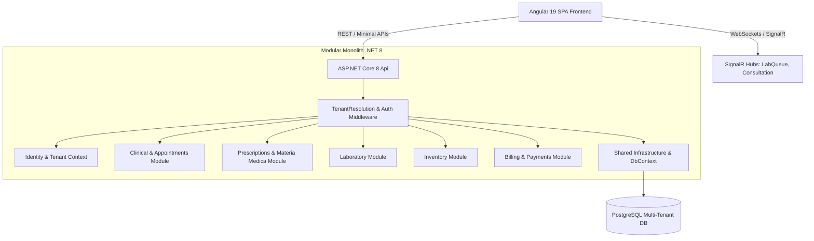

# Mattei Grid — System Architecture Document

Version: 1.0 (Initial Skeleton Baseline)  
Platform: B2B Multi-Tenant Clinical Management Platform for Electro-Homoeopathy Practices

---

## 1. System Overview

Mattei Grid digitizes the entire patient care lifecycle in an electro-homoeopathy clinic—from scheduling, intake, and consultation, through custom dilution/vehicle remedy selection from the Mattei Grid, to real-time laboratory preparation and automated billing/payments.



---

## 2. Backend Architecture (.NET 8 Modular Monolith)

The backend is organized as a **Modular Monolith** using Clean Architecture boundaries inside each module.

### Solution Layout
- **`src/MatteiGrid.Api/`**: Entrypoint application.
  - Registers module services and middleware.
  - Maps endpoint route groups (`/api/v1/auth`, `/api/v1/patients`, `/api/v1/appointments`, `/api/v1/prescriptions`, `/api/v1/lab`, `/api/v1/billing`, etc.).
  - Hosts SignalR hubs (`/hubs/lab-queue`, `/hubs/consultation`).
- **`src/MatteiGrid.Modules.<Module>/`**: Bounded contexts:
  - `Identity`: Users, staff, credentials, refresh tokens, role & permission assignments.
  - `Clinic`: Tenant clinic profiles, settings, policies.
  - `Patients`: Patient records, emergency contacts, medical history.
  - `Appointments`: Scheduling, queue status, doctor assignment.
  - `Clinical`: Consultations, clinical notes, diagnosis, vitals.
  - `Prescriptions`: Digital prescription authoring, remedy dilution & vehicle formulation.
  - `MateriaMedica`: Digital electro-homoeopathy remedy database, indications, organ affinities.
  - `Laboratory`: Preparation queue, order tracking, batch compounding, lab technician updates.
  - `Inventory`: Medicine stock levels, batch tracking, automatic deduction upon compounding.
  - `Billing`: Invoices, line items, payment tracking, state machine handling, Razorpay webhooks.
  - `Administration`: System config, audit log viewer, clinic staff management.
  - `Notifications`: SMS/Email alerts, appointment and billing reminders.
  - `Reports`: Clinical outcomes, collection reports, inventory velocity.
- **`src/MatteiGrid.Shared.Kernel/`**:
  - Core primitives, `Result<T>` pattern, Domain Events, Permissions list.
- **`src/MatteiGrid.Shared.Infrastructure/`**:
  - `AppDbContext`: Entity Framework Core DbContext with multi-tenant global query filters.
  - `TenantSaveChangesInterceptor`: Automatically sets `ClinicId` on tenant-owned entities.
  - `TenantResolutionMiddleware`: Resolves tenant from JWT claims or request context.

---

## 3. Multi-Tenancy Architecture (Tenancy Model A)

Mattei Grid uses **Tenancy Model A**: each user belongs to exactly one clinic for MVP.

1. **Tenant Identification**: Authenticated requests carry `ClinicId` in their validated JWT claims.
2. **Context Resolution**: `TenantResolutionMiddleware` injects `ICurrentTenantContext` for the request scope.
3. **Database Segregation**:
   - Every tenant table has a `ClinicId` column.
   - EF Core global query filters automatically append `WHERE ClinicId = @currentTenant` to all read queries.
   - `TenantSaveChangesInterceptor` automatically assigns `entity.ClinicId = currentTenant.ClinicId` before saving.
   - Composite unique constraints `(ClinicId, Id)` ensure entities from different clinics cannot link or cross-reference.

---

## 4. Frontend Architecture (Angular 19 SPA)

The frontend is built with Angular 19 using standalone components, modern control flow (`@if`, `@for`), and Signals.

```text
frontend/src/app/
├── core/                  # Singleton services, models, auth guards, interceptors
│   ├── api.service.ts     # Central HTTP client wrapper
│   ├── auth.service.ts    # Token storage, login state, user claims
│   ├── auth.guard.ts      # Route guard verifying JWT and permissions
│   └── models.ts          # Strongly-typed TypeScript interfaces matching backend DTOs
├── layout/                # Shell layout, sidebar, tenant badge, navigation
│   └── nav-shell.component.ts
└── features/              # Feature domain modules
    ├── auth/              # Login, tenant selection, password reset
    ├── dashboard/         # Role-tailored dashboard
    ├── patients/          # Patient directory & registration
    ├── consultation/      # Consultation room & prescription builder
    ├── laboratory/        # Real-time laboratory preparation queue
    ├── inventory/         # Stock levels, items, batches
    └── billing/           # Invoices, payment links, payment records
```

---

## 5. Real-Time Communication (SignalR)

- **/hubs/lab-queue**: Broadcasts updates when doctors submit prescriptions requiring lab compounding. Lab technicians receive instant UI notifications without polling.
- **/hubs/consultation**: Notifies clinical staff of patient arrival, status transitions, and appointment queue progression.

---

## 6. Authentication & Authorization

- **Authentication**: JWT Bearer tokens with short expiry (e.g., 60 minutes) + HTTP-only secure refresh token cookie (`__Host-mattei-refresh-token`).
- **Authorization**: Granular permissions (e.g. `Patients.View`, `Prescriptions.Create`, `Laboratory.Process`, `Billing.Manage`).
- **Predefined Roles**:
  - `ClinicAdmin`: Full clinic configuration, staff roles, billing, reports.
  - `Doctor`: Patient consults, clinical notes, digital prescriptions.
  - `LabTechnician`: Lab queue, medicine preparation, stock deduction.
  - `Pharmacist`: Inventory dispensing, medicine stock management.
  - `Receptionist`: Patient registration, scheduling appointments, collecting initial invoice payments.

---

## 7. Logging & Diagnostic Architecture

Mattei Grid features a centralized, enterprise-grade structured logging pipeline powered by Serilog, DynamicProxy AOP interception, and synchronized dual-file rolling.

### 7.1. Log Streams & Storage Strategy
1. **Application Log (`logs/matteigrid-app-yyyyMMdd_{seq}.log`)**:
   - Automated method entry and exit tracing with execution duration (ms).
   - In-method domain warnings (`[WARN]`), handled errors (`[ERROR]`), and fatal crash dumps (`[FATAL]`).
2. **Request & Response Log (`logs/matteigrid-requests-yyyyMMdd_{seq}.log`)**:
   - Incoming HTTP requests: Method, URL path, query params, client IP, ClinicId, UserId, and TraceId.
   - Outgoing HTTP responses: Status code, total request latency (ms), content length, and TraceId.
3. **Interactive Console**: ANSI color-coded stream for real-time terminal diagnostics during development.

### 7.2. Synchronized Coordinated Rolling & Retention
- **10,000 Lines Cap**: When **either** file reaches 10,000 lines, `SynchronizedDualFileSink` rolls **both** files simultaneously (`_001.log` -> `_002.log`), guaranteeing exact cross-file correlation.
- **14-Day (2-Week) Auto-Purge**: Files older than 14 days are automatically removed on rotation and at startup.

### 7.3. Automated Method Flow Tracing (AOP)
- Module services are registered via `.AddLoggedScoped<TInterface, TImpl>()`.
- `ServiceLoggingInterceptor` intercepts all interface calls:
  - `[INFO] [ENTRY] Class.Method(arguments)` (sanitized via `LogSanitizer` to mask passwords, tokens, and PHI).
  - High-precision `Stopwatch` execution timing.
  - `[INFO] [EXIT] Class.Method (Elapsed: X ms)` on completion.
  - `[ERROR] [EXCEPTION] Class.Method failed after X ms: {Message}` on caught error.

### 7.4. Global Crash Protection & RFC 7807 Handling
- `GlobalExceptionHandlingMiddleware` catches unhandled exceptions escaping endpoints, emits a `[FATAL] [SYSTEM_CRASH]` log with full stack trace and tenant context, and returns a secure RFC 7807 `ProblemDetails` response with an opaque `TraceId`.

