# Mattei Grid — Entity Relationship Diagram v4 (Final, post second cross-check)
*Phase 0 design artifact | Supersedes v1, v2, v3 | Status: Draft for sign-off*

v4 fixes a real consistency gap from v3: `ClinicId` was missing from `ClinicalNote`, `PrescriptionItem`, `Refund`, and `PaymentLink` — now added to all four, uniformly, so the single `SaveChangesInterceptor` / global-query-filter / CI-leakage-test pattern applies without per-entity exceptions. Also fixes: `InventoryTransaction.Quantity` → signed `QuantityDelta`; adds the `LaboratoryOrderId`/`TransactionType` `CHECK` constraint; defines `Consent.PolicyVersion` instead of leaving `Version` ambiguous; documents the three invariants a `PreviousVersionId UNIQUE` constraint does *not* cover.

---

## 1. What's ERD vs. what's a DB constraint vs. what's a service rule (stated once, not repeated per field)

| Layer | Lives where | Examples in this schema |
|---|---|---|
| ERD (conceptual shape) | This diagram | Entities, relationships, nullability, PK/FK |
| DB constraint (enforced by Postgres) | Migration, not diagram | `UNIQUE(PreviousVersionId)` — no forking; `CHECK (TransactionType = 'LabDeduction' ⟺ LaboratoryOrderId IS NOT NULL)` on `InventoryTransaction`; partial unique index on `Payment.RazorpayPaymentId WHERE NOT NULL` — idempotency; `UNIQUE(ClinicId, Id)` + composite `(ClinicId, ParentId)` FK on `Patient`, `Prescription`, `PrescriptionItem`, `Invoice`, `Payment`, `LaboratoryOrder` — defense-in-depth tenant isolation beyond the EF global query filter (Sec 15.2). `PrescriptionItem` needs this on *all three* of its master-data references (`MedicineId`, `DilutionId`, `VehicleId`), since it's the highest-fan-out cross-tenant risk point in the schema — a plain FK on any one of them would let an item silently reference another clinic's medicine, dilution, or vehicle. |
| Service/application rule | Application code, not schema | Invoice status transitions (see the Payment State Machine doc); "revision blocked once any payment recorded"; permission checks; Prescription revision invariants — same `ConsultationId` as the version it revises, and `Version = PreviousVersion.Version + 1` (a DB trigger could enforce these too, but that's more machinery than a guard clause in the Prescription creation service needs) |

---

## 2. Entity Relationship Diagram

```mermaid
erDiagram
    CLINIC ||--o{ STAFF : employs
    CLINIC ||--o{ ROLE : defines
    CLINIC ||--o{ PATIENT : registers
    CLINIC ||--o{ MEDICINE : "master data"
    CLINIC ||--o{ DILUTION : "master data"
    CLINIC ||--o{ VEHICLE : "master data"
    CLINIC ||--o{ INVENTORY_ITEM : stocks
    CLINIC ||--o{ APPOINTMENT : schedules
    CLINIC ||--o{ CONSULTATION : contains
    CLINIC ||--o{ PRESCRIPTION : owns
    CLINIC ||--o{ LABORATORY_ORDER : owns
    CLINIC ||--o{ INVOICE : generates
    CLINIC ||--o{ PAYMENT : records
    CLINIC ||--o{ CONSENT_RECORD : collects
    CLINIC ||--o{ NOTIFICATION_LOG : records
    CLINIC ||--o{ AUDIT_LOG : records

    STAFF ||--o{ STAFF_ROLE : assigned
    ROLE ||--o{ STAFF_ROLE : assigned_to
    ROLE ||--o{ ROLE_PERMISSION : grants
    PERMISSION ||--o{ ROLE_PERMISSION : granted_via

    PATIENT ||--o{ APPOINTMENT : books
    PATIENT ||--o| HOMEOPATHIC_CASE_RECORD : has
    STAFF ||--o{ APPOINTMENT : assigned_as_doctor
    APPOINTMENT ||--o| CONSULTATION : leads_to
    PATIENT ||--o{ CONSULTATION : has
    STAFF ||--o{ CONSULTATION : conducts
    CONSULTATION ||--o{ CLINICAL_NOTE : contains
    CONSULTATION ||--o{ CONSULTATION_OBSERVATION : records
    STAFF ||--o{ CLINICAL_NOTE : writes
    STAFF ||--o{ CONSULTATION_OBSERVATION : observes
    CONSULTATION ||--o{ PRESCRIPTION : produces

    MATERIA_MEDICA_ENTRY ||--o{ PRESCRIPTION_ITEM : referenced_by
    MATERIA_MEDICA_ENTRY ||--o{ PRACTITIONER_NOTE : annotated_by
    STAFF ||--o{ PRACTITIONER_NOTE : writes
    MEDICINE ||--o{ PRESCRIPTION_ITEM : specifies
    DILUTION ||--o{ PRESCRIPTION_ITEM : specifies
    VEHICLE ||--o{ PRESCRIPTION_ITEM : specifies
    PRESCRIPTION ||--o{ PRESCRIPTION_ITEM : contains
    PRESCRIPTION ||--o| PRESCRIPTION : revises
    STAFF ||--o{ PRESCRIPTION : finalizes

    PRESCRIPTION ||--o| LABORATORY_ORDER : generates
    STAFF ||--o{ LABORATORY_ORDER : prepares
    LABORATORY_ORDER ||--o{ INVENTORY_TRANSACTION : triggers
    MEDICINE ||--o{ INVENTORY_ITEM : stocked_as
    INVENTORY_ITEM ||--o{ INVENTORY_TRANSACTION : "adjusted by"

    CONSULTATION ||--o{ INVOICE : "bills to"
    PRESCRIPTION ||--o| INVOICE : "may generate"
    PATIENT ||--o{ INVOICE : billed_to
    INVOICE ||--o{ INVOICE_LINE_ITEM : itemizes
    MEDICINE ||--o{ INVOICE_LINE_ITEM : "traceable to"
    INVOICE ||--o{ PAYMENT : settled_by
    STAFF ||--o{ PAYMENT : records_manual
    PAYMENT ||--o{ REFUND : refunded_by
    STAFF ||--o{ REFUND : processes
    INVOICE ||--o{ PAYMENT_LINK : has

    PATIENT ||--o{ CONSENT_RECORD : provides
    STAFF ||--o{ NOTIFICATION_LOG : triggers
    PATIENT ||--o{ NOTIFICATION_LOG : receives
    STAFF ||--o{ AUDIT_LOG : performs

    CLINIC {
        guid Id PK
        string Name
        string RazorpayLinkedAccountId
        datetime CreatedAt
        datetime UpdatedAt
    }
    STAFF {
        guid Id PK
        guid ClinicId FK
        guid IdentityUserId "integration ref to ASP.NET Identity — not modeled further here"
        string Name
        string Phone
        bool IsActive
        datetime CreatedAt
        datetime UpdatedAt
    }
    ROLE {
        guid Id PK
        guid ClinicId FK
        string Name
        datetime CreatedAt
        datetime UpdatedAt
    }
    PERMISSION {
        guid Id PK
        string Code "system-seeded, no timestamps needed"
        string Description
    }
    STAFF_ROLE {
        guid StaffId PK, FK
        guid RoleId PK, FK
        datetime CreatedAt "grant event — security-relevant"
    }
    ROLE_PERMISSION {
        guid RoleId PK, FK
        guid PermissionId PK, FK
    }
    PATIENT {
        guid Id PK
        guid ClinicId FK
        string Name
        string Phone
        date DOB
        string Gender "nullable"
        string PrimaryChiefComplaint "nullable"
        string ProfileStatus "Incomplete / Complete"
        int CompletionPercentage "0 to 100"
        text MissingFieldsJson "serialized missing mandatory fields"
        bool IsArchived
        bool IsAnonymized
        datetime CreatedAt
        datetime UpdatedAt
    }
    HOMEOPATHIC_CASE_RECORD {
        guid Id PK
        guid ClinicId FK
        guid PatientId FK, UK
        string Occupation "nullable"
        string MaritalStatus "nullable"
        string Address "nullable"
        string Diet "Veg / Non Veg / Mixed"
        string PlaceOfBirth "nullable"
        string Religion "nullable"
        string Education "nullable"
        string SocialStatus "nullable"
        string NutritionalStatus "nullable"
        string FamilyStatus "Nuclear / Joint / Extended"
        text ChiefComplaintTimeline "nullable - mandatory for 100%"
        string Location "nullable"
        string SensationAndPathology "nullable"
        text AggravatingModalities "nullable"
        text AmelioratingModalities "nullable"
        string AilmentsFrom "nullable"
        string ConcomitantSymptoms "nullable"
        string Thermals "nullable - mandatory for 100%"
        text Appetite "nullable - mandatory for 100%"
        text Thirst "nullable - mandatory for 100%"
        text Sex "nullable"
        text Sleep "nullable - mandatory for 100%"
        text Dreams "nullable"
        string CravingsAndAversions "nullable"
        text Stool "nullable"
        text Urine "nullable"
        text Sweat "nullable"
        text Breath "nullable"
        text Discharges "nullable"
        text WillAndEmotions "nullable"
        text UnderstandingAndIntellect "nullable"
        text Memory "nullable"
        text Disposition "nullable"
        string Temperament "nullable"
        text PastIllnesses "nullable"
        text FamilyHistory "nullable"
        string ConsciousState "nullable"
        string GeneralAppearance "nullable"
        string BuiltAndNutrition "nullable"
        string SystemicSigns "nullable"
        string BloodPressure "nullable"
        int PulseRate "nullable"
        decimal TemperatureF "nullable"
        int RespiratoryRate "nullable"
        decimal HeightCm "nullable"
        decimal WeightKg "nullable"
        decimal BMI "nullable"
        text KnownAllergies "nullable - mandatory for 100%"
        bool HasKnownAllergies "nullable"
        bool AllergyAssessmentConfirmed "mandatory for 100%"
        bool IsMandatoryDossierComplete
        int DossierCompletionPercentage
        datetime CreatedAt
        datetime UpdatedAt
    }
    APPOINTMENT {
        guid Id PK
        guid ClinicId FK
        guid PatientId FK
        guid DoctorStaffId FK
        datetime StartAt
        datetime EndAt
        string Status
        string OverrideReason "nullable — double-booking override"
        datetime CreatedAt
        datetime UpdatedAt
    }
    CONSULTATION {
        guid Id PK
        guid ClinicId FK
        guid PatientId FK
        guid DoctorStaffId FK
        guid AppointmentId FK "nullable — walk-ins"
        string Status "Scheduled/InProgress/Completed/Cancelled/NoShow"
        string CaseType "Acute/Chronic/Gynaecological/Surgical/Epidemic/Others"
        string ProvisionalDiagnosis "nullable"
        string FinalDiagnosis "nullable"
        string Outcome "UnderTreatment/Cured/Relieved/Referred/Otherwise/Expired"
        datetime StartedAt
        datetime CompletedAt "nullable"
    }
    CONSULTATION_OBSERVATION {
        guid Id PK
        guid ClinicId FK
        guid ConsultationId FK
        guid StaffId FK
        datetime ObservationDate
        string ReactionType "InitialEncounter/Amelioration/HomoeopathicAggravation/DiseaseAggravation/NoChange/NewSymptoms"
        string KentsObservation "nullable (Obs 1..12)"
        string SecondPrescriptionAction "nullable (Continue/WaitAndWatch/ChangePotency/ChangeRemedy)"
        text Notes
        datetime CreatedAt
    }
    CLINICAL_NOTE {
        guid Id PK
        guid ClinicId FK
        guid ConsultationId FK
        guid StaffId FK
        text Content
        datetime CreatedAt
        datetime UpdatedAt "mutable per Sec 5.4"
    }
    MATERIA_MEDICA_ENTRY {
        guid Id PK
        string Code
        string Name
        string Family
        text Description
        text Indications
        datetime CreatedAt
        datetime UpdatedAt
    }
    PRACTITIONER_NOTE {
        guid Id PK
        guid ClinicId FK
        guid MateriaMedicaEntryId FK
        guid StaffId FK
        text Content
        datetime CreatedAt
        datetime UpdatedAt
    }
    MEDICINE {
        guid Id PK
        guid ClinicId FK
        guid MateriaMedicaEntryId FK "nullable"
        string Name
        bool IsActive
        datetime CreatedAt
        datetime UpdatedAt
    }
    DILUTION {
        guid Id PK
        guid ClinicId FK
        string Label "e.g. 6X, 30C"
        datetime CreatedAt
        datetime UpdatedAt
    }
    VEHICLE {
        guid Id PK
        guid ClinicId FK
        string Name
        datetime CreatedAt
        datetime UpdatedAt
    }
    PRESCRIPTION {
        guid Id PK
        guid ClinicId FK
        guid ConsultationId FK
        guid PreviousVersionId FK, UK "nullable, unique — enforces linear v1-v2-v3 chain"
        int Version
        string Status
        guid FinalizedByStaffId FK "nullable until finalized"
        text DietAndRegimenInstructions "nullable — Organon §259-263"
        text GeneralInstructions "nullable"
        datetime CreatedAt
        datetime FinalizedAt "nullable — no UpdatedAt: immutable once finalized"
    }
    PRESCRIPTION_ITEM {
        guid Id PK
        guid ClinicId FK "needed for composite tenant-FK on Medicine/Dilution/Vehicle refs below"
        guid PrescriptionId FK
        guid MedicineId FK
        guid DilutionId FK "mandatory — Sec 5.6 sequential workflow"
        guid VehicleId FK "mandatory — Sec 5.6 sequential workflow"
        string SelectionMethod "Repertorial / NonRepertorial"
        string ElectricityPolarity "red/blue/green/yellow/white — validated value, not a table"
        decimal Quantity
        string Dosage
        string Frequency "OD/BD/TDS/QID/Hourly/SOS"
        string Duration
        string Instructions "nullable"
    }
    LABORATORY_ORDER {
        guid Id PK
        guid ClinicId FK
        guid PrescriptionId FK
        guid PreparedByStaffId FK "nullable"
        string Status "Received..Collected"
        string RejectionComment "nullable"
        datetime CreatedAt
        datetime UpdatedAt
    }
    INVENTORY_ITEM {
        guid Id PK
        guid ClinicId FK
        guid MedicineId FK
        decimal QuantityOnHand
        decimal ReorderLevel
        datetime CreatedAt
        datetime UpdatedAt
    }
    INVENTORY_TRANSACTION {
        guid Id PK
        guid ClinicId FK
        guid InventoryItemId FK
        guid LaboratoryOrderId FK "nullable — only set for LabDeduction"
        string TransactionType "LabDeduction/StockReceipt/ManualAdjustment/Wastage"
        decimal Quantity
        string Reason
        datetime CreatedAt "append-only ledger — no UpdatedAt"
    }
    INVOICE {
        guid Id PK
        guid ClinicId FK
        guid PatientId FK
        guid ConsultationId FK "mandatory anchor"
        guid PrescriptionId FK "nullable — see open questions"
        string Status "Pending/PartiallyPaid/Paid/Cancelled/Refunded"
        decimal TotalAmount
        datetime CreatedAt
        datetime UpdatedAt
    }
    INVOICE_LINE_ITEM {
        guid Id PK
        guid InvoiceId FK
        guid MedicineId FK "nullable — traceability only, never the display source"
        string Description "frozen snapshot at invoice time"
        decimal Quantity
        decimal UnitPrice
        decimal Amount
        datetime CreatedAt "immutable snapshot — no UpdatedAt"
    }
    PAYMENT {
        guid Id PK
        guid ClinicId FK
        guid InvoiceId FK
        decimal Amount
        string Source "Digital/Manual"
        string Mode "UPI/Cash/Card"
        string Status "Pending/Confirmed/Failed"
        string RazorpayPaymentId "nullable — partial unique index at DB layer, see Sec 1"
        guid RecordedByStaffId FK "nullable, manual only"
        datetime CreatedAt
        datetime UpdatedAt "tracks async status transition"
    }
    REFUND {
        guid Id PK
        guid ClinicId FK
        guid PaymentId FK
        guid StaffId FK
        decimal Amount
        string Reason
        string Status "Initiated/Processed/Failed"
        string RazorpayRefundId "nullable"
        datetime CreatedAt
        datetime UpdatedAt
    }
    PAYMENT_LINK {
        guid Id PK
        guid ClinicId FK
        guid InvoiceId FK
        string TokenHash
        string Status "Active/Expired/Consumed"
        datetime ExpiresAt
        datetime ConsumedAt "nullable — domain-specific, no generic UpdatedAt"
        datetime CreatedAt
    }
    CONSENT_RECORD {
        guid Id PK
        guid ClinicId FK
        guid PatientId FK
        string ConsentType
        string PolicyVersion "snapshot of the active policy identifier at grant time — not a FK to a versions table"
        datetime GrantedAt
        datetime RevokedAt "nullable"
    }
    NOTIFICATION_LOG {
        guid Id PK
        guid ClinicId FK
        guid PatientId FK
        guid TriggeredByStaffId FK "nullable — system-triggered"
        string Channel
        string Status
        datetime CreatedAt
        datetime SentAt "nullable"
    }
    AUDIT_LOG {
        guid Id PK
        guid ClinicId FK
        guid StaffId FK
        string Action
        string EntityType
        guid EntityId
        text Metadata
        datetime CreatedAt "immutable — never UpdatedAt, by definition of an audit trail"
    }
```

---

## 3. Unresolved business questions — required before EF migrations are written

Two cross-check rounds have now closed the *schema-mechanics* gaps (tenant enforcement, inventory quantity semantics, revision invariants, constraint placement). What's left are genuine **business decisions** the schema can't make for you — these aren't bugs, they're PRD gaps this exercise surfaced. Answer these before Phase 1 scaffolding, not during it:

1. **Can a clinic bill a consultation fee when no prescription is issued?** The schema supports it either way (`Invoice.ConsultationId` mandatory, `PrescriptionId` nullable) — but if billing only ever happens via prescription finalization, that flexibility is more than you need. Confirm the actual billing triggers.
2. **What are the real `Consultation.Status` values?** Likely candidates — `Scheduled, InProgress, Completed, Cancelled, NoShow` — but don't treat that as decided. It also depends on *when* a Consultation row is created: at appointment-booking time, or only when the doctor actually starts seeing the patient. That timing decision determines whether "Scheduled" is even a meaningful state for this entity.
3. **Does inventory ever get restocked or manually adjusted?** The ledger structure (`InventoryTransaction.TransactionType`) already supports `StockReceipt`/`ManualAdjustment`/`Wastage` alongside `LabDeduction` — that's a schema decision already made. What's still open is *product* scope: does the MVP Administration UI (5.12) actually need a "receive stock" screen on day one, or can that be entered directly for MVP while the UI catches up in a later phase?
4. **Is per-role permission customization actually needed at MVP?** Schema is already many-to-many regardless of the answer — this only affects how much Admin UI (5.12) gets built in Phase 1. Recommend deferring the customization UI and shipping fixed seeded roles for MVP.
5. **Is consent-policy-version tracking needed for MVP, or deferrable to the Phase 4 compliance hardening pass?** The field semantics are now defined (`ConsentRecord.PolicyVersion` — a snapshot string, not a versioned-documents subsystem) so this is cheap to keep either way. Your compliance risk to weigh, not mine to decide silently.
