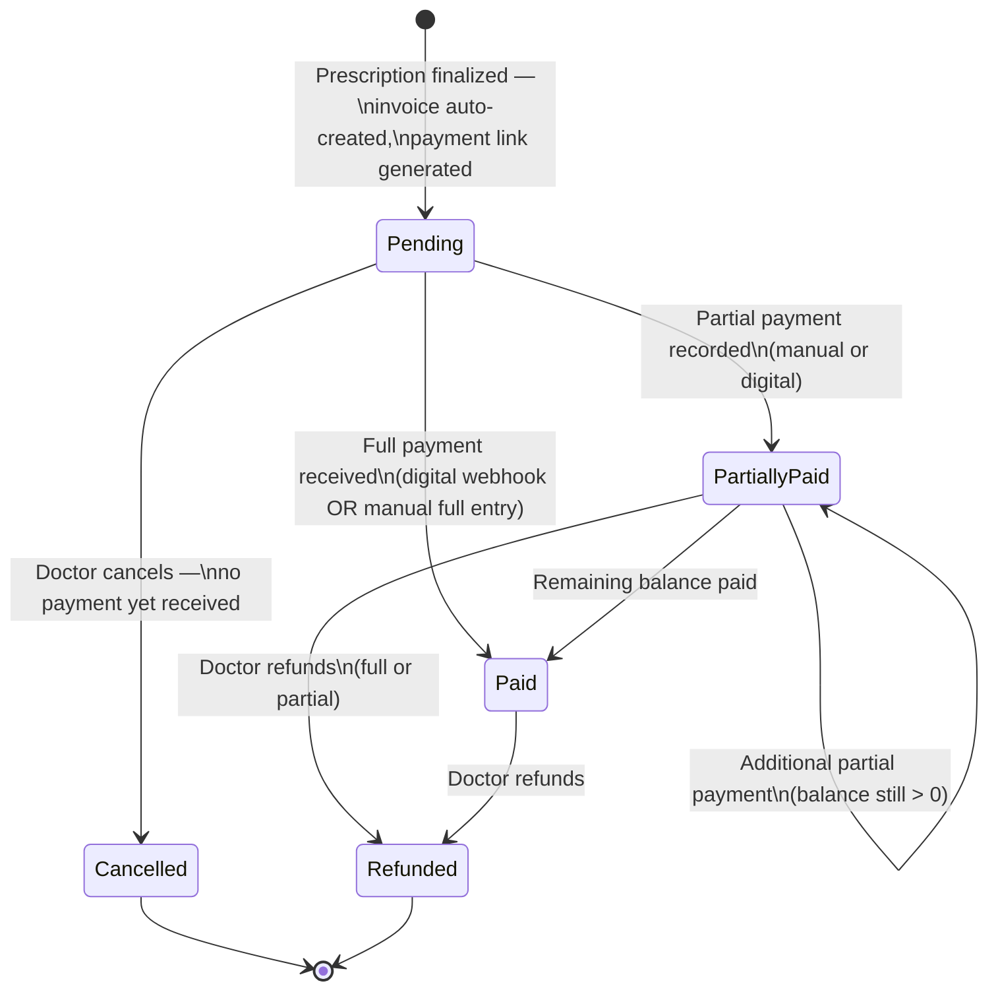
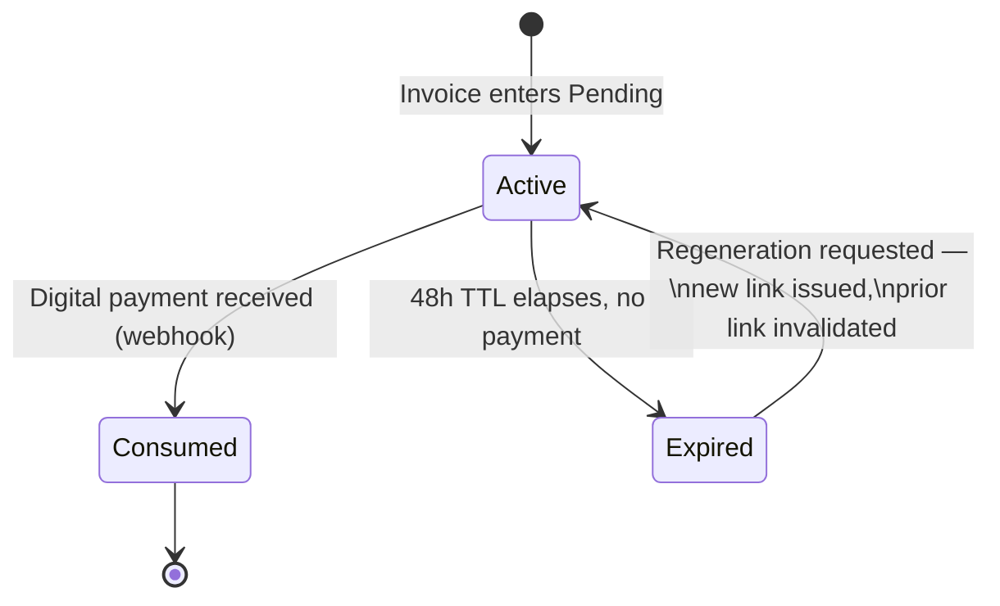

# Mattei Grid — Payment / Invoice State Machine
*Phase 0 design artifact | Derived from PRD v2.3, Sections 5.6, 5.9, 7, 15.1 | Status: Draft for sign-off*

This defines two coupled but distinct lifecycles that the PRD describes in prose but never formalizes:

1. **Invoice Status** — the billing state of record.
2. **Payment Link Lifecycle** — a sub-concern of Invoice while it's `Pending`, governing the UPI link's 48-hour TTL and regeneration.

Keeping these separate matters: collapsing "link expired" into the invoice status would force you to invent a fake invoice state for something that's actually a property of one payment channel, not the invoice itself.

---

## 1. Invoice Status — primary state machine

### Guard conditions (must be enforced in code, not just documented)

| Transition | Guard | Why |
|---|---|---|
| `Pending → Cancelled` | Only reachable if **zero** payments exist against the invoice | You can't "cancel" money that's already moved — that's a refund, not a cancellation. Modeling this as one combined "void" state would hide which case you're in when reconciling (Sec 5.9). |
| `Pending/PartiallyPaid → Paid` | Sum of `Payment.Amount` for the invoice ≥ `Invoice.TotalAmount` | Prevents a manual entry error (wrong amount typed) from silently marking an under-paid invoice as `Paid`. |
| `* → Refunded` | Only reachable from `PartiallyPaid` or `Paid` | Same logic as Cancelled — a refund requires a prior payment to reverse. |
| Prescription revision | Blocked once Invoice leaves `Pending` (i.e., once *any* payment is recorded) | Already a locked PRD rule (5.6). Enforced at the **Prescription** entity, but the guard reads Invoice state — this is the actual coupling between Billing and Clinical modules that your NetArchTest boundary rules need to allow explicitly, not implicitly. |
| Revision after `Cancelled`/`Refunded` | Creates a **new** Prescription + **new** Invoice; the old Invoice is never reopened | `Cancelled` and `Refunded` are true terminal states for that invoice row. |

### Open question the PRD does not answer — flagging, not assuming

**Overpayment**: what happens if a manual payment entry exceeds `Invoice.TotalAmount`? The PRD never addresses this. Two options, pick one before building Billing:
- Reject the entry at data-entry time (simplest, recommended for MVP).
- Allow it and track a credit balance against the patient (adds real complexity — a whole mini-ledger — for an edge case that's mostly a typo in practice).

I'd default to **reject at entry** for MVP and revisit only if it turns out cash overpayment is common in practice.

---

## 2. Payment Link Lifecycle — sub-state of `Pending`

- A link expiring does **not** change Invoice status — the invoice stays `Pending` indefinitely until someone acts (ties into the Billing & Collections workflow, Sec 6.3, and the reminder/reconciliation dashboards).
- Manual payment (Cash/Card) bypasses this sub-lifecycle entirely — it goes straight to the Invoice transition with no dependency on link state (per 5.6/5.9, "no webhook dependency").

---

## 3. Data modeling recommendation (new — not specified in PRD, needed to implement the above)

The PRD names Payment as a concept but doesn't model it as an entity. Two calls I'm making here, both flagged for your confirmation rather than silently assumed:

1. **`Refund` as its own table**, not a negative-amount `Payment` row: `RefundId, PaymentId (FK), Amount, Reason, StaffId, CreatedAt`. A negative payment row is cheaper to build but makes the audit trail (Sec 11 requires a dedicated `AuditLogs`-grade trail) ambiguous when someone reads the Payment table later and has to remember "negative means refund." An explicit table costs one extra join and removes that ambiguity entirely.
2. **`PaymentLink` as its own table**, not fields bolted onto `Invoice`: `PaymentLinkId, InvoiceId (FK), Token, Status, ExpiresAt, CreatedAt`. This lets you keep a full history of every link issued per invoice (useful for support/dispute cases — "the patient says they never got a link") instead of overwriting a single `LinkStatus` column on Invoice every time one expires.

Both feed directly into the ERD next.
